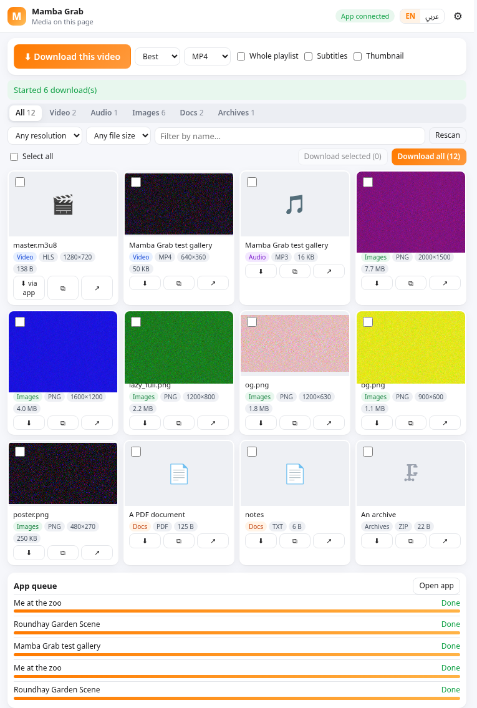
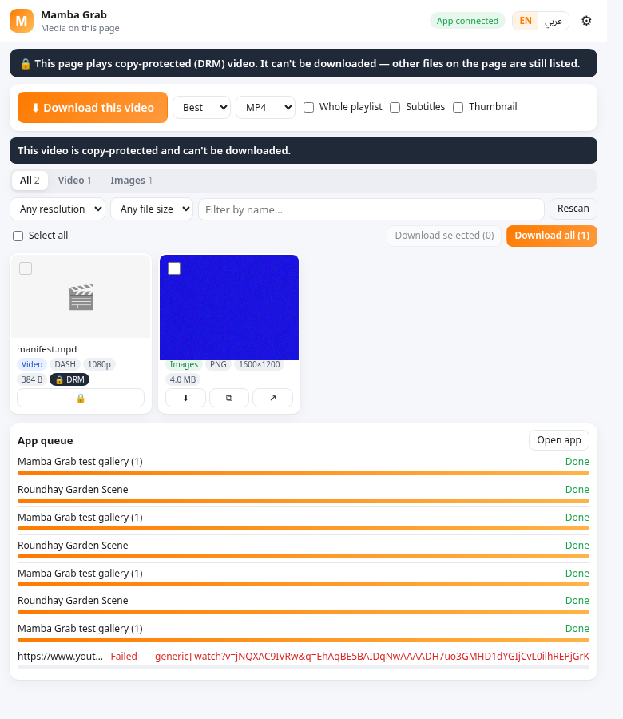
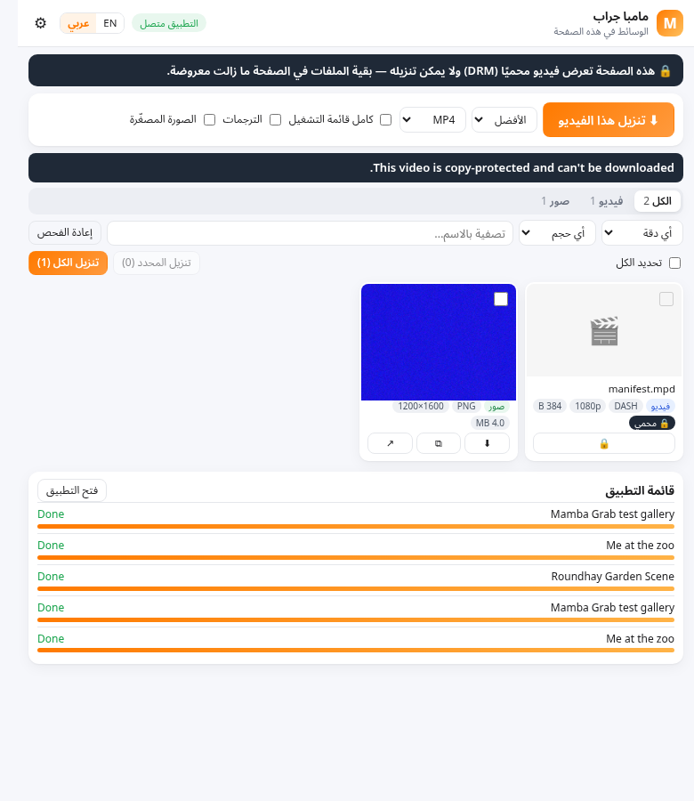
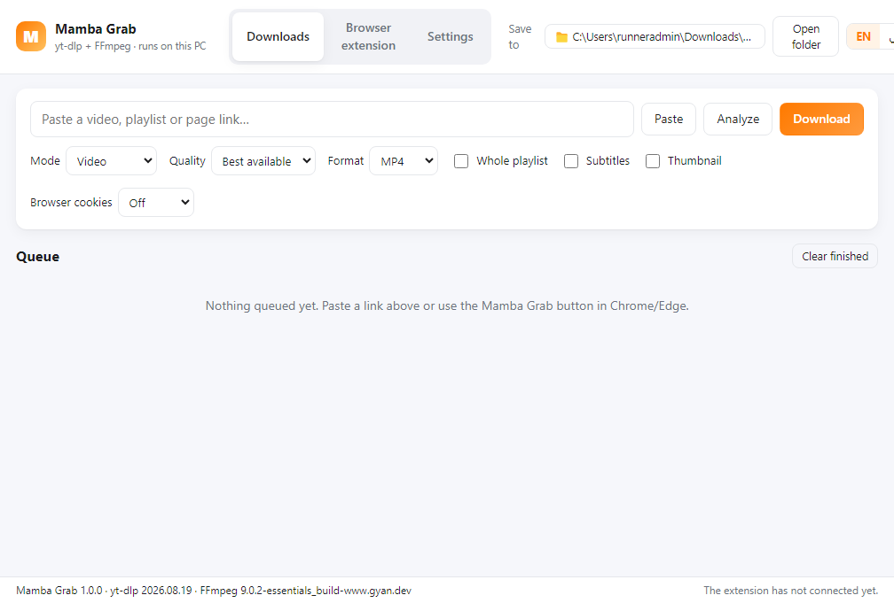

# Mamba Grab

**Grab every video, audio file, image and document on a page — Chrome/Edge extension (Manifest V3) + a small offline Windows companion app (yt-dlp + FFmpeg).** Part of the Mamba family (Mamba Convert, Mamba Reader…). Personal use, EN/AR.

> **No DRM circumvention.** Mamba Grab never decrypts Widevine / PlayReady / FairPlay content, never extracts keys and never touches the browser's CDM. When a page plays copy‑protected video it says so: **“This video is copy-protected and can't be downloaded.”**

| Popup | DRM page | Arabic |
|---|---|---|
|  |  |  |

Companion app (screenshot from the Windows CI build):



## Download

From the [latest release](https://github.com/heisenberg0066/mamba-grab/releases/latest):

* **`MambaGrab-Setup-1.0.0-x64.exe`** – installs the app (per user, no admin) **and registers the native‑messaging host for Chrome and Edge** (also Chromium/Brave).
* **`MambaGrab-Extension-1.0.0.zip`** – the browser extension (the same folder is also installed with the app).
* `MambaGrab-1.0.0-win-x64.zip` – the app without installer (it registers the host itself on first start).

## Install the extension (developer mode – there is no Web Store listing)

1. Run the Setup. (The extension folder is then also at `%LOCALAPPDATA%\Programs\Mamba Grab\resources\extension` — Start menu → **Mamba Grab Extension Folder**, or the app's **Browser extension** tab → *Open extension folder*.)
   Or unzip `MambaGrab-Extension-1.0.0.zip` to a **permanent** folder (e.g. `Documents\Mamba Grab Extension`) — Chrome loads it from there every time.
2. **Chrome:** open `chrome://extensions` · **Edge:** open `edge://extensions`.
3. Turn on **Developer mode** (Chrome: switch top‑right · Edge: left sidebar).
4. Click **Load unpacked** and select the folder that contains `manifest.json`.
5. Pin **Mamba Grab** (puzzle‑piece icon → pin). The popup shows **App connected** when the companion app is reachable.

The extension key is fixed in the manifest, so its ID is always **`phppfdojjnpdbkpoiphpcefadmnkmjfd`** — that is the ID the native host allows. Chrome may show a "developer mode extensions" reminder at start‑up; that is normal for unpacked extensions.

## What it does

**Extension**
* Finds media on the current page (all frames): `<video>/<audio>` (+ `<source>`, `<track>` subtitles, posters), images — **highest resolution available**: `srcset`/`<picture>`, lazy‑load attributes (`data-src`, `data-original`, `data-lazy-src`, `data-zoom-image`, …), linked originals, CSS backgrounds, `og:image`, and original‑size URL rewrites for Wikimedia, X/Twitter, Pinterest, Reddit, Google/Blogger, YouTube thumbnails, Amazon, Imgur, Shopify, WordPress, Tumblr, Flickr, Cloudinary and generic `?w=` resizers (each rewrite is verified with a HEAD request before it is used) — PDFs, Office files, e‑books, text/CSV, archives.
* **Network sniffing** (observational `webRequest`) catches what players load: HLS (`.m3u8`, variants + best resolution parsed), DASH (`.mpd`), progressive MP4/WebM/audio, big lazily‑loaded images. Segment requests are grouped away; blob/MSE players are listed as “player (blob)” and handed to yt‑dlp by page URL.
* Popup grid with thumbnails, type tabs with counts, **resolution** (≥200/500/1000/1920 px) and **file‑size** filters, name search, select / **Download selected** / **Download all**, copy link, open.
* **One‑click “Download this video”** in the popup (quality: best/2160…360, format MP4/MKV/WEBM or MP3/M4A/OPUS/WAV/FLAC, playlist, subtitles, thumbnail), as a hover button on any video, and in the right‑click menu.
* Talks to the app through **Native Messaging** (live queue in the popup). If the app isn't installed/running it **falls back to the browser's downloads API** for direct files (saved to `Downloads/Mamba Grab/<site>/`). The app is started automatically when needed (setting).
* **Your session, opt‑in only:** *Settings → Use my browser session* — `Off` (default) · `Send this site's cookies to the app` (asks for the optional `cookies` permission; only cookies of the page/media URL are written to a temporary cookies.txt for that one job and deleted afterwards) · `yt-dlp --cookies-from-browser` (chrome/edge/firefox/brave). Only for content you can already view.
* **DRM detection:** EME `encrypted` events / `HTMLMediaElement.mediaKeys`, licence‑server requests, HLS `SAMPLE-AES`/FairPlay/Widevine/PlayReady keys, DASH `ContentProtection`, DRM‑only services (Netflix, Disney+, Prime Video, Max, Hulu, Apple TV+, Spotify…), and yt‑dlp's own DRM errors → the clear copy‑protected message, locked cards, and no download. Other (non‑DRM) files on such a page are still listed. (Plain HLS AES‑128, which is not DRM, works normally.)

**Companion app (Windows x64, Electron)**
* Bundles **yt‑dlp** and **FFmpeg**; yt‑dlp keeps itself up to date (daily `yt-dlp -U` on a per‑user copy, or *Settings → Update yt‑dlp now*). The app's own Electron runtime doubles as yt‑dlp's JavaScript runtime, so YouTube works without installing Deno/Node.
* Paste a link → **Analyze** (title, thumbnail, duration, available resolutions, subtitles, exact format list) → **Download**: best quality or capped quality, MP4/MKV/WEBM or audio MP3/M4A/OPUS/WAV/FLAC, a specific format ID, **playlists** (with item ranges), **subtitles** (languages, auto‑subs, embed), **thumbnails** (save/embed), metadata.
* **Queue** with progress, speed, ETA, playlist position, cancel/retry/remove/show file, parallel downloads (1–4), persisted across restarts; output folder picker; tray icon so the extension can reach it with the window closed; notifications.
* EN/AR (RTL) UI in the style of the other Mamba apps.

## How the pieces talk

```
popup / content script ──chrome.runtime──► service worker ──Native Messaging (stdio)──► mamba-grab-host.bat
      (scan, filters)                     (sniffing, DRM, downloads API)                  └ "Mamba Grab.exe" in Node mode → host.js
                                                                                                      │ named pipe \\.\pipe\mamba-grab-<user>
                                                                                          Mamba Grab app (queue) ──► yt-dlp.exe + ffmpeg.exe
```
The installer writes `HKCU\Software\Google\Chrome\NativeMessagingHosts\com.ammar.mambagrab` and `HKCU\Software\Microsoft\Edge\NativeMessagingHosts\com.ammar.mambagrab` (+ Chromium, Brave) → `resources\host\com.ammar.mambagrab.json`; uninstall removes them. When the host has to start the app it launches it through Explorer so the app is not tied to the browser's process job.

## Development

```bash
npm ci
npm test                       # unit + queue + native-host tests; real yt-dlp/FFmpeg downloads when yt-dlp is on PATH
node build/dev-register.js     # Linux/macOS dev: register the host so a Chromium browser reaches `electron .`
node test/e2e-extension.js     # Playwright: loads the unpacked extension, local fixture pages + real public pages
node test/host-e2e.js          # through the *registered* host → auto-launched app → real download
node build/pack-extension.js && npx electron-builder --win --x64   # (CI does this on windows-latest)
```
CI (`.github/workflows/build-windows.yml`, windows-latest) runs the test-suite against the bundled Windows yt‑dlp/FFmpeg, builds the Setup/zip, self‑tests the packaged app, installs it silently, checks the Chrome/Edge registry entries, and runs the host end‑to‑end test exactly the way Chrome starts a native host. Tags `v*` publish a release.

## Known gaps

* No Web Store listing → developer‑mode install, with Chrome's “developer mode extensions” notice.
* `--cookies-from-browser chrome/edge` often fails on Windows for current Chrome/Edge (app‑bound cookie encryption, locked cookie DB while the browser runs). Use **“Send this site's cookies to the app”** instead (recommended) or Firefox.
* Streams (HLS/DASH/blob players) need the app; without it only direct files download.
* Original‑size rewrites cover common sites; elsewhere you get the largest size the page itself references.
* Sites can change at any time; yt‑dlp updates fix most extractor breakages (automatic daily update). Some sites rate‑limit or ask for sign‑in/bot checks.
* DRM‑protected media is intentionally unsupported.

MIT · uses [yt-dlp](https://github.com/yt-dlp/yt-dlp) (Unlicense) and [FFmpeg](https://ffmpeg.org) (GPL build from gyan.dev).
